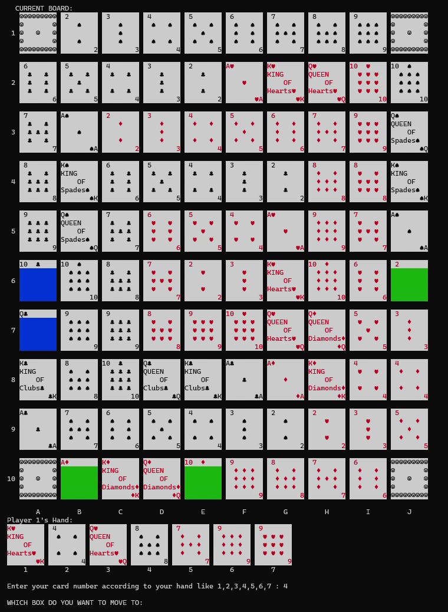

# Console Sequence

A personal C++ implementation of a two-player Sequence-style card-and-board game in a Windows terminal.

## Demonstration



A cropped frame from the owner's existing recording. It illustrates the original terminal interface, not a fresh end-to-end test of this revision. No audio is included. [Frame provenance](docs/DEMONSTRATION.md).

## Gameplay and implementation

Players receive seven cards and take turns choosing a hand position **1–7** and a board square using uppercase columns **A–J** and rows **1–10**. The source maintains a 10×10 integer-encoded board, a shuffled deck, jack-related behavior, and a sequence win check. Press a key through the hand-off prompts before each turn.

This is a procedural programming project with functions for dealing, rendering, input, and win checking. Its existing rules are retained, including its custom card/board encodings; it is not advertised as full commercial-game rule compliance.

## Build and run on Windows

The source uses `<windows.h>` and `<conio.h>` for terminal colours/input. Native Linux/macOS compilation is not claimed. Install Visual Studio with the Desktop development with C++ workload and CMake, then run:

```powershell
cmake -S . -B build
cmake --build build --config Release
.\build\Release\console-sequence.exe
```

For a single-configuration generator the executable is directly under `build/`. Alternatively, from an x64 Visual Studio Developer Command Prompt:

```bat
cl /nologo /EHsc /std:c++17 /utf-8 Sequence.cpp /Fe:console-sequence.exe
```

Use a wide terminal for the board/card rendering. Build only the entry source named above; compiling every `.cpp` together may include multiple `main` functions.

## Validation and limitations

See [validation notes](docs/VALIDATION.md) for observed build/test results and known limitations. Build success does not establish every game rule as correct. Run focused tests with `cmake --build build --config Debug` and `ctest --test-dir build -C Debug --output-on-failure`. There is no hosted deployment.

## Project context

Personal experimental project by Syed Muhammad Rayyan Hassan.
